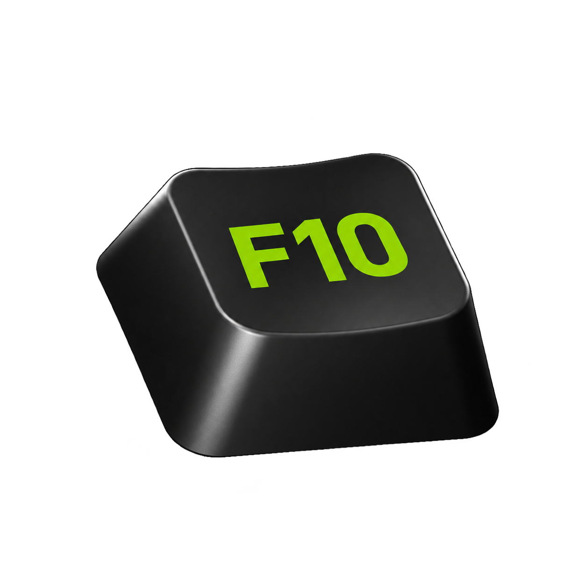

# F10 visual direction

Approved visual baseline, 24 October 2026. Q84-Q87 establish the interface system; the realistic F10 keycap selected on 24 October closes the logo decision. The name is F10. Native implementation, export variants, scaling and release qualification remain separate.

## Direction

F10 is a local replay recorder for gamers. It should feel like a compact recording utility: legible at a glance, direct controls, truthful source and audio state. The user selected NVIDIA App/ShadowPlay as the reference for dark surfaces, green emphasis and restrained typography, combined with Discord-inspired rounded controls and solid icons.

The screen's question is: **What will F10 record when I finish setup?** Its distinct elements are the linked replay-duration controls, the two selected audio devices and their segmented level previews. Preserve those rather than adding decorative cards, badges or a marketing introduction.

## Reference versus F10 choice

| Reference | Verified observation | F10 interpretation |
| --- | --- | --- |
| [NVIDIA App](https://www.nvidia.com/en-us/software/nvidia-app/) | Official product reference for the recording/overlay context. | A neutral dark utility with a restrained green primary action. These are reference principles, not a claim that the CSS tokens below are NVIDIA App's internal design system. |
| [NVIDIA-hosted design example](https://github.com/nvidia-isaac/video_to_data/blob/main/docs/chord/_ds/basic-nvidia-design-system-f939d4e7-d0bb-4994-9e26-a471f04510c4/readme.md) | Records NVIDIA Green `#76B900` and uses Hanken Grotesk as an open substitute for NVIDIA Sans. This is a project-specific example, not a universal corporate UI specification. | Use that green as the preview accent. Use Hanken Grotesk explicitly as an alternative, rather than bundling NVIDIA Sans without established redistribution rights. |
| [Discord Design Systems Team](https://discord.com/blog/improving-mobile-with-squircles-styles-and-spacing) | Describes consistent rounded corners across buttons, inputs and containers, and common shape rules across desktop/mobile. | One consistent rounded control family, comfortable hit areas and clear hover/pressed/focus states. |
| [Phosphor Icons](https://github.com/phosphor-icons/core) | Provides an MIT-licensed solid icon family. | Use its fill-weight microphone, microphone-slash and folder-open icons. These are Phosphor assets chosen for F10, not extracted Discord glyphs. |

## Approved identity

The product name is **F10**, without Recorder as an alternate product name. Explain its purpose through the user journey. Internal project names, namespaces, executables and existing user folders are implementation identities, not automatically renamed by this decision.

The user selected the **realistic dark F10 keycap, option B**, by attaching the exact artwork again on 24 October 2026. This closes Q87's provisional-logo review. Preserve the selected image's shape, perspective, green F10 legend, dark material and highlights. The illustrated and softened-edge versions, abstract monograms and reviewer-preferred compact hybrid are not the approved logo.

Canonical asset: [f10-logo.png](m0-review/assets/f10-logo.png). [Approval record and SHA-256](m0-review/assets/f10-logo-approved.json). The attachment is copied unchanged; no recolouring, letter replacement or redesign was performed. The generated lettering is not certified as an exact Segoe UI match, nor is the logo's green certified as the exact interface token. The selected visual remains approved without silently changing its pixels. The interface still uses the colour and type rules below.

Use the selected asset in the review screens. Small tray/export variants, Windows scaling and native integration still require their own work; preserve the identity when preparing them. No vendor logo is substituted for F10.

## Accepted base tokens

Q84-Q86 accept this F10 baseline, not official NVIDIA/Discord specifications. The 24/14/12px type scale remains subject to readability checks at Windows scaling levels during implementation.

| Role | Value |
| --- | --- |
| Outer ground | `#090909` |
| Application ground | `#141414` |
| Surface / field | `#1E1E1E` / `#262626` |
| Structural rule / interactive boundary | `#3D3D3D` / `#686868` |
| Primary / secondary text | `#F2F2F2` / `#B8B8B8` |
| Action and ordinary audio signal | `#76B900` |
| Caution / error | `#E8B35A` / `#F48B91` |
| Typeface | Hanken Grotesk, locally served variable font; Segoe UI fallback |
| Title / body / helper | 24px semibold / 14px / 12px |
| Control / dialog corner radius | 8px / 12px |
| Form control height | 40px; compact icon controls 36px |
| Field gap / column gap | 18px / 24px |

Green carries the primary action, active input feedback and normal meter activity. It does not tint every panel or label. Warning colours require a meaningful warning; real audio thresholds and calibration remain implementation work. Red plus a slashed icon identifies mute; colour is not its only cue.

## Components

- One green Finish action. Secondary and icon buttons use neutral fills with distinct hover/pressed states. Keyboard focus remains visible.
- Phosphor solid icons at 20px, with accessible names and tooltips. Accepted processing-state exception (24 October 2026): use the rounded outline Hourglass selected from Lucide Animated consistently for finalizing/saving/recovering, retaining existing state sizes and colours. See the preview asset record for geometry and licences. No visible microphone On/Off label or duplicate Unavailable label beside the icon. The device selector conveys missing input and its icon is disabled. The icon and Alt+F2 consistently mute/unmute an enabled microphone. Ordinary same-device reconnection preserves enabled/muted intent; explicitly disabled input or restored permission requires explicit enabling.
- The folder icon stays inside the field's right edge, with reserved text padding and a usable hit area.
- Controls remain paired in the accepted two-column form while each has sufficient width. Collapse according to the form's content width, not the browser's unrelated outer width. Short windows scroll; text does not shrink to fit.
- Source-scope help is one conditional sentence. The replay estimate sits beneath duration/folder. Track guidance appears only when two tracks is selected.
- Errors stay beside their fields and preserve draft choices. Optional missing/off audio never blocks Finish or requires confirmation. A failed recording start appears above the single primary button, which becomes Retry; show Starting… while attempting and advance only on success. The review board demonstrates empty-folder and out-of-range duration feedback. Other source, permission, storage and start-failure flows remain specified in the review notes; actual device/filesystem validation is later work.

## Restraint

Desktop shell refinement accepted 23 October 2026: use the supplied NVIDIA app screenshot as the structural reference for a compact titlebar, sidebar and content heading, with Discord-inspired rounded navigation and controls. Put the approved F10 keycap logo at top left and standard Minimize/Maximize/Close controls at top right. Omit maintainer/proposed-beta text inside the product shell. Overlay is a button with its hotkey at the bottom of the sidebar; Quit is absent there. Use a prominent, rounded status box and integrated shortcut hints in action buttons. Keep the accepted neutral palette and typography. Native window behavior and small-size asset qualification remain separate work.

Round 19 refines navigation to use a short green active marker at the outer sidebar edge, detached from the selected button. Use Audio as the shared section heading and Audio tracks above its chosen setting. Problem notices float at the top with a dismiss X and relevant recovery action; dismissal never clears the underlying status or resumes capture.

Q98-Q100 adopt one rounded notification family for accepted requests, saved results, information and problems, replacing the legacy green rectangular toast. Retain the 96% opaque backgrounds, fully opaque content and individual dismiss X. Stack simultaneous notices with recording-blocking problems first. Saved-success notices offer Open file/Open folder and expire after roughly five seconds, pausing while hovered or keyboard-focused; problem notices do not auto-expire. Save replay keeps its normal label while the buffer fills.

Use neutral UI surfaces without green casts, gradients, glow, glass, decorative grids or repeated accent outlines. The approved keycap logo retains its material shading and highlights as an identity-asset exception; do not transfer that treatment to controls and panels. Give hierarchy to the recording controls, not an oversized heading. Keep labels short and avoid em dashes. Add motion only for control feedback when it becomes useful; no entrance choreography is needed in setup.

## Assets and implementation boundary

The preview uses a locally served [Hanken Grotesk font under OFL 1.1](https://github.com/google/fonts/tree/main/ofl/hankengrotesk), Phosphor icons under MIT, the attributed Lucide hourglass and the approved realistic F10 keycap. Sources, licences and downloaded hashes are in [the preview asset record](m0-review/assets/ASSETS.md). Runtime browsing, device monitoring, native folder selection and audio recording are not part of the HTML preview.

Taste Skill 2.1.4 app-screen run: `true-black-flat`, seed `2001345957`, with palette/type retained. The accepted form supersedes its generic dashboard shell; the user-selected NVIDIA green action, rounded controls and solid icons supersede its white primary and outline-icon defaults. The saved direction sheet is under ignored `artifacts/m0-review/taste-brand/`. No marketing-page imagery or motion requirements apply.

The base direction and selected keycap logo are accepted. The screen-by-screen layout reviews are recorded in the review pack. The original Taste audit and alternative logo reports remain historical evidence, not an override of the user's choice.

## Reusable F10 design skill

The reusable [F10 design skill](../skills/f10-design/SKILL.md) is created from this approved visual baseline. It routes agents to this guide, the canonical asset/provenance and accepted screen decisions. It does not freeze unfinished native behavior or replace the user’s authority to change the design.
