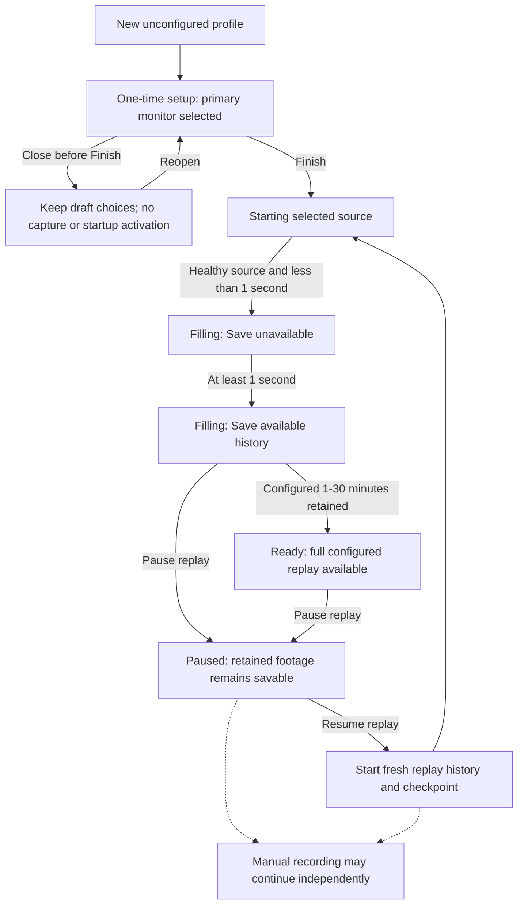
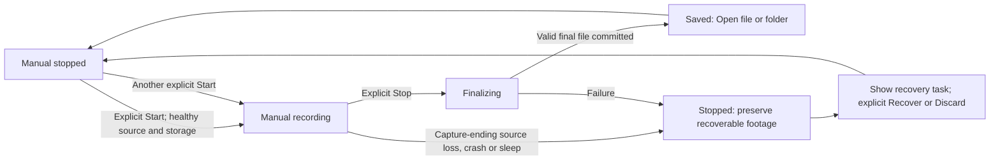
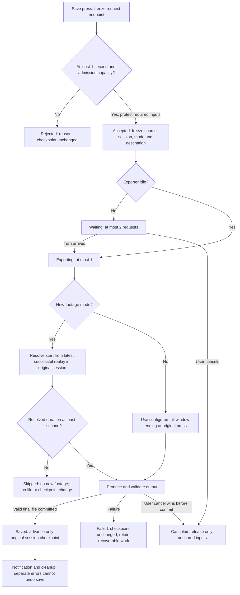
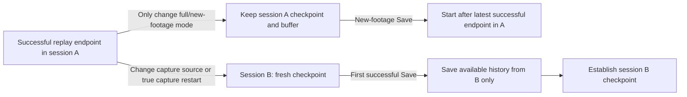
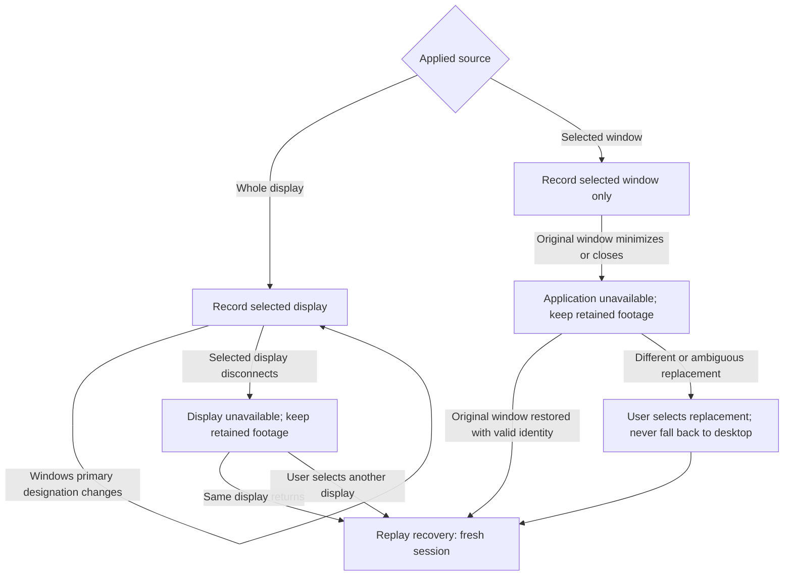
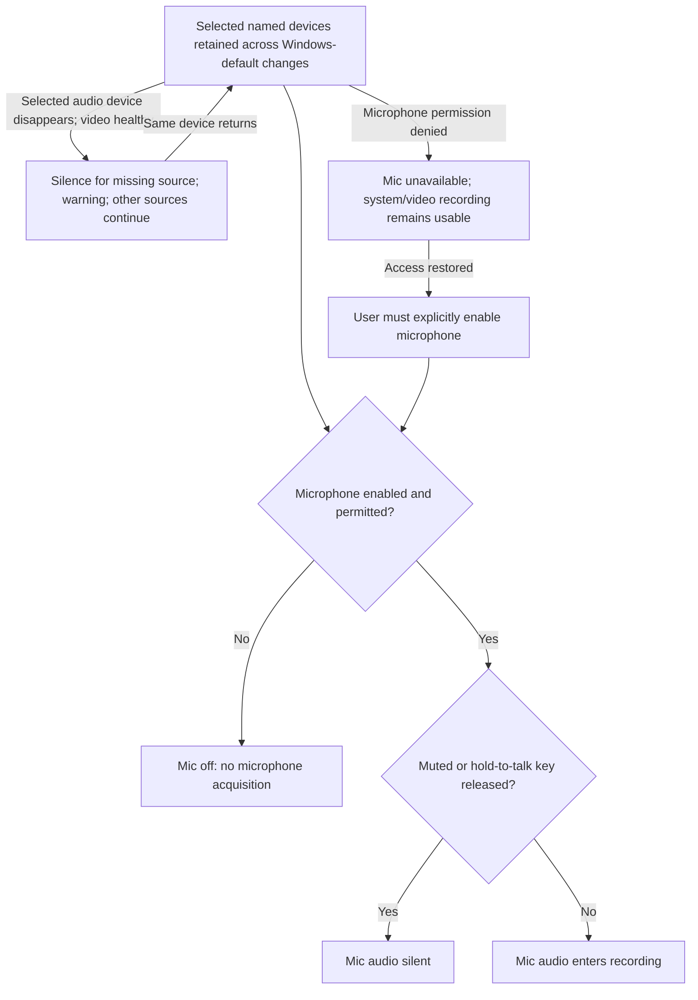
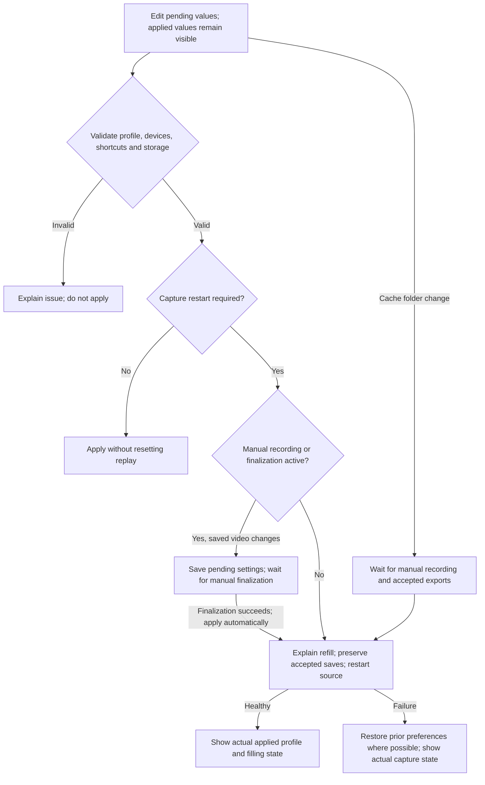
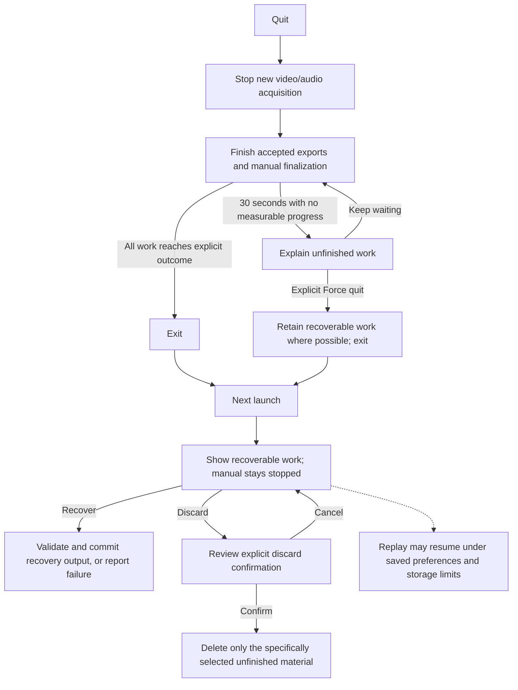

# M0 wireframes and state flows

**Planning closeout, 25 October 2026:** Q158 and confirmed worker/media testing boundaries are recorded in the [consolidated spec](../beta-spec.md), published as [issue #10](https://github.com/ju57/f10-recorder/issues/10). M0 planning is complete. Unresolved engineering and every mandatory release gate remain open; the historical review/research notes below are not runtime acceptance.

Current identity, accepted 24 October 2026: **F10**, with the realistic keycap attached by the maintainer as the approved logo. [Brand guide](../brand-guidelines.md), [canonical asset](assets/f10-logo.png), [approval record](assets/f10-logo-approved.json), and [design skill](../../skills/f10-design/SKILL.md). Logo selection and the visual baseline are closed; native variants and remaining M0 engineering work are separate. Historical next-screen/logo-review notes below reflect earlier stages.

Q127-Q128 overlay closeout is accepted: open on the active application's monitor without changing the configured capture source; clicking outside the panel and media viewer dismisses the overlay without forwarding that click. The sample implements dismissal only inside its background scene, excluding panel/viewer and open confirmation-dialog interactions. Verified panel and viewer clicks keep the overlay open; a background click removes both while retaining the background. Reopening preserves manual Recording and 5:00 retained replay history. Multi-monitor placement is an intended native behavior, not simulated by this single-scene board. Overlay layout review is complete; the Q129-Q131 indicator refinements and content-selection controls are accepted for this layout pass. Q132-Q134 Tray, Q135-Q137 Recovery/Discard and Q138-Q143 Exit are accepted. The logo and brand baseline are also closed; remaining M0 work concerns engineering decisions and qualification.

Overlay microphone shortcut refinement: the current mute/unmute shortcut is a hotkey chip inside the microphone icon button, matching the other action controls. Remove the detached label under the microphone device name. The shared tooltip still names Mute/Unmute and the current binding; customized shortcuts propagate from Controls. This is a review UI change only.

Overlay Gallery follow-up: tabs now reuse the desktop Captures underline treatment. Recording preview adds a playback-only volume slider/mute, Open file location and a bin icon. Screenshot preview has location/bin controls without audio controls. The bin opens the existing Q104 Recycle Bin confirmation, names the selected item and preserves it on Cancel/Escape. Confirm updates the shared sample catalogue and closes the removed item's viewer. No files are accessed, no Explorer window opens and no real item is recycled. Preview volume changes do not change recording audio levels; playback itself remains illustrative.

Verified preview volume 42% mutes to 0% and restores to 42%, while system recording volume remains 100%. Cancel and Escape preserve the item/viewer and keep the overlay open. Confirm removes only the selected sample recording while another recording remains; screenshot preview has no volume control. Follow-up approval changes the ready badge to Replay ready to save and removes the overlay export summary/details row. Desktop export progress and shared save feedback remain.

Overlay manual status text is replaced by a stopped square, red recording dot with elapsed time, finalizing hourglass with recorded duration, or unknown question-mark icon. Focusable tooltips/accessible names explain each state. Verified Recording with 12:34, replay pause retaining the Recording icon, Finalizing blocking a new Start, and completion restoring Stopped. There is no manual-recording pause state. The gallery no longer contains internal Playback controls are illustrative / Sample preview wording; Play/Pause labels use product language. Actual playback remains unimplemented in this sample, with that limitation documented outside the product panel.

Overlay Q123-Q126 are accepted with the maintainer's reference refinements: a left/right edge panel replaces the centered panel, recent-capture thumbnails and Gallery remain inside the overlay, and settings that do not require capture restart can be changed there. The prototype starts on the left, matching the reference, and remembers side changes within the sample scenario. Both desktop Controls and Overlay settings expose the same side preference. The overlay home remains narrow with the background visible; selecting media explicitly opens an adjacent viewer, while gallery/settings navigation stays in the panel. Gallery has Recordings/Screenshots tabs and internal scrolling; export details/cancellation remain in desktop Captures. Restart-required source/encoding/device choices stay in desktop settings.

The sample includes immediate save-mode, 0-100% audio-level and save/problem notification controls, alongside side selection. These use the shared applied state without resetting replay; accepted exports retain their original mode/identity. Current shortcut hints come from Controls. Close/Escape hides only the sample overlay and viewer, the configured overlay shortcut reopens it, and Pause/Resume leaves manual recording independent. Thumbnails reuse the existing illustrative assets. The viewer's recording Play/Pause is a layout simulation, not media playback or a real file read.

Verified right-edge placement leaves most of the scene visible, side survives close/reopen, immediate volume displays update, and both recording/screenshot thumbnails open the matching viewer. Desktop Controls and Overlay settings share side selection; gallery tabs support arrow-key selection. The 30-screenshot sample scrolls inside the drawer (2165px content / 680px viewport), and selecting the last thumbnail preserves the scrolled position. Queue full shows 1 saving / 2 queued and disables Save. Close/Escape preserves the background representation, Alt+Z reopens the panel, and pausing replay during manual recording keeps the manual Recording state. Native overlay placement/focus, playback, global shortcuts and capture exclusion remain separate implementation and qualification work.

Overlay scope clarification: select **Overlay** in the review board. It represents quick controls available over the desktop, applications and games whenever F10 is running, including while the F10 desktop window stays open. The configured overlay shortcut (default Alt+Z) opens/closes that surface; Escape closes only the overlay and returns focus to the previous application. Opening it does not switch capture sources, close the desktop window or require a game/active recording. These are intended native behaviors. The HTML now models Close/Escape by removing the overlay panel/viewer while retaining a background representation; it does not switch actual OS focus. Q123-Q126 are resolved with the edge-panel, in-overlay gallery/settings refinements below.

Diagnostics Q119-Q122 are accepted. The current sample shows separate Recording service, Capture source, Instant replay, Manual recording and Audio statuses; disconnected recording values are Unknown with last-known selections labelled. Only current problems appear, with relevant settings links and expandable Recent events. Dismissing a floating warning does not remove the underlying problem. The review scenario selector now supports Diagnostics, including a distinct Output folder unavailable example. The removed Storage drive-space section is not relocated here.

Restart replay buffer requires confirmation and stays disabled during manual recording, finalization or accepted exports, with a visible blocker. Cancel preserves history. Confirming clears the sample history and starts a fresh session, preserving deliberate pause. Source-unavailable/low-storage states require fixing their blocker first. Reconnect is a sample failed attempt that keeps status Unknown; it does not contact a service.

Preview report creates a redacted sample snapshot; Refresh replaces it and Hide preview closes it. Export downloads exactly the displayed text as `f10-diagnostics-review-sample.txt`. Application/OS/GPU/driver fields are explicitly examples or not inspected; no real device identifiers, paths, filenames, logs or media are collected. The browser reports that download started, without claiming verified native save completion. The external Sample report export selector can demonstrate a failure without downloading; preview remains available for retry and the shared failure pop-up is used. No report is uploaded.

Verified Ready has no current problems, disconnected states remain Unknown, a dismissed notice leaves its problem visible, microphone permission failure is conditional, and Review save folder focuses the unchanged Recordings folder field. Checked restart blocking during recording/finalization/queued exports, cancellation preserving 5:00 history, paused restart retaining Paused with 0:00, and active restart showing Filling with 0:00. The downloaded sample matched the inspected preview exactly; simulated export failure retained that preview. Native report collection/redaction/export, reconnect and replay restart are not implemented or qualified by this board.

Review draft v4, 22 October 2026 (Europe/Lisbon). Grounded in the [release decisions](../release-plan.md) and [displayed-presentation ADR 0006](../adr/0006-match-displayed-presentation.md). Q69-Q72 and Q74-Q76 are accepted, with round 13 refinements to setup identity, microphone default and folder selection. Q73 is resolved by Q92 in the Overview review.

Open [wireframes.html](wireframes.html) for the visual review board. Navigation and scenario selection operate on sample UI only. Audio level meters show static sample levels inspired by the supplied segmented-meter reference; they do not listen to devices. Disabled/missing inputs show inactive meters. It does not connect to F10, capture pixels/audio, register shortcuts, read media, change settings/startup, upload diagnostics or represent hardware acceptance. Example devices, folders, filenames, durations and storage figures are illustrative. Screen arrangement and wording are proposals; accepted behavior remains the contract. Print the board to review the current screen; use the screen selector for other views.

The completed [three-reviewer Taste Skill audit](taste-audit.md) records the frozen inputs, evidence, prioritized findings and review recommendations. The audit covers the frozen v3 inputs. The current v4 board applies accepted follow-up refinements and a new brand exploration; its HTML intentionally differs from that audit snapshot.

The first-run layout is accepted in round 15. Q77-Q83 are applied in v4 as appropriate to the review stage; the [F10 visual direction](../brand-guidelines.md) is a draft shown on that accepted layout. Apply the audit according to the review stage: capture-scope clarity and coherent microphone/error states matter to the design; focus and breakpoint defects affect the sample artifact; final visual tuning and real native/device/scaling behavior need later work. The basic layout can be approved without implementing every simulated failure. Define error/recovery semantics before freezing behavior, and preserve the audit's original evidence and stated limits.

Q84-Q87 accept the base palette, typography, rounded controls and solid icons in round 16. The existing logo remains a wireframe placeholder pending its dedicated review before final brand approval. The setup state review and subsequent Overview decisions are recorded below.

Q88-Q91 are accepted in round 17 with the maintainer's audio simplification: neither audio input is required for setup. Finish allows absent/unconfigured/off system audio and microphone, without a confirmation checkbox. Users may choose devices later. The selector already identifies a missing microphone; its disabled icon and inactive meter need no duplicate Unavailable label.

Final first-run refinement: remove the horizontal divider between Start F10 with Windows and Finish, retaining the existing spacing and button placement.

Further first-run refinements, 23 October 2026: label the video summary Video Default Settings. Inset setup dropdown chevrons 14px from the right edge and reserve text space so arrows do not crowd the rounded corner or selected value. Retain native select interactions.

Ordinary reconnection of the same microphone preserves enabled/muted intent; permission restoration still needs explicit enabling. Missing and access-blocked states must remain distinct and preserve selected-device identity. Start failure appears above the single primary button, which becomes Retry and shows Starting… while attempting; remain in setup until video starts successfully. Optional missing audio is not a start failure.

The board offers Off for either audio device, removes the system-audio confirmation/blocker, preserves microphone intent across its missing-device example, and carries missing/off states into sample Overview. Verified Finish with both inputs off and both inputs missing, correct sample Overview states, preserved two-track selection, and restored mute after the example microphone returns. The duplicate missing-microphone helper and continuation checkbox are absent. No device substitution is implied. A two-track choice remains selected when inputs are off/missing; corresponding silence follows the existing audio policy.

Corrected review-artifact defects in the preceding state review: invalid duration text survives unrelated form rerenders, field error accessibility attributes survive those rerenders, choosing a valid example folder clears its prior error, and a muted meter exposes Muted as its accessible value. Verified duration 31 and an empty folder block Finish, survive changing track selection, and clear on correction to 17 minutes and a chosen folder. Source, permission, folder-write, low-storage and failed-start visuals remain to be illustrated; the sample Finish assumes a successful video start. No device or recorder validation is claimed.

Overview review, 23 October 2026: Q92 resolves Q73; Q93/Q94/Q96 are accepted. The revised board emphasizes replay, puts audio in a shared section, keeps idle exports compact and separates Stop all capture from everyday actions. The desktop shell uses the supplied NVIDIA/Discord references: logo titlebar, custom window controls, icon sidebar, Overlay button with hotkey, no sidebar Quit or maintainer/proposed-beta text, integrated shortcut hints and a prominent status box. Window controls show explanatory preview notices only; closing the actual app keeps the established hide-to-tray policy. The board does not control any native window or recorder.

Round 19 resolves Q95 and Q97: the source/video summary links to Capture & Video, and audio device/track summaries link to Audio. Problem notices float at the top with a dismiss X and contextual recovery action. Dismissal hides only the notice and leaves the issue visible in the status badge; it does not change recording state or disabled commands. Rename the shared section Audio and label the chosen track setting Audio tracks. Detach the green navigation marker from its button and place it at the sidebar's outer edge, following the supplied NVIDIA crop. The original screenshots are user-supplied visual references, not authority to change NVIDIA/Discord settings or reuse account data.

Follow-up polish: floating notice backgrounds use 96% opacity while text and controls remain fully opaque. The detached green marker spans the full selected button height and is inset 4px from the sidebar's outer edge so it does not touch the window boundary.

Audio summaries now share one responsive grid and the same icon/label/value structure. Audio tracks uses a Phosphor fill rows icon, matching typography and spacing, and retains its Audio settings shortcut instead of sitting separately at the far right.

Stop all capture retains its visible label and now includes a solid square stop icon for easier recognition.

Round 20 accepts Q98-Q100: stable Save replay wording while filling; one shared rounded pop-up family for accepted requests, successes and all other feedback; a small stack with independent dismiss buttons and blocking problems first. Saved-success pop-ups offer Open file/Open folder and expire after five seconds of unpaused time, pausing for pointer hover or keyboard focus. Problems remain until dismissed/resolved; successful results remain in Captures. The old green rectangular toast and its container are removed. Source and microphone unavailable is a new combined review scenario.

Round 21 accepts Q101-Q103 with separate Recordings and Screenshots tabs. Recording rows show replay/manual type, date/time, duration and file/folder actions; screenshots omit duration. The unfinished-recording banner now uses the common floating notice, while Recovery · 1 remains available after dismissal. Saved file unavailable preserves successful save history, disables Open file and offers a sample Recheck response. Q101 puts pending exports above the media tabs and saved files; the empty queue uses a compact idle row below the list. Original request order and timestamps remain unchanged.

Follow-up: replace file-type icons beside filenames with 88 × 50px thumbnails. Recordings use a representative frame from the file; screenshots use the saved image. Three original illustrative game-frame SVGs stand in for real media on this board; these are not actual CS2 screenshots or extracted video frames. No user media is read. Native extraction, caching and preview fallback remain implementation work. The existing unavailable-file example may retain its illustrative thumbnail while Open file remains disabled.

Verified both recording thumbnails and the screenshot thumbnail load at 88 × 50px. In the full-queue sample, exactly one export section appears above the tabs and saved files, with original request times ordered; no page horizontal overflow was measured at the current review width. Canceling all three sample requests returns the single compact idle section below saved files. Script syntax and whitespace checks pass. These are review-board checks only.

Round 22 adds saved-file selection and scrolling. Q104 accepts Windows Recycle Bin with confirmation. Selection spans both tabs, with a total and recording/screenshot breakdown, selected-row styling, Clear selection and a bin icon button. The bin retains Remove selected as its tooltip and accessible name, and is disabled without selection. Its simple solid geometry is original wireframe artwork. Select all affects only the current tab. The confirmation lists all selected filenames and defaults focus to Cancel. Cancel preserves selection; confirming changes only the sample lists and shows a sample-removal notice. Empty tabs show an empty state. Active exports and unfinished recovery material are not saved-file rows and cannot be selected here.

The failed-save example now offers Review save folder rather than Storage. Its link opens Storage at the labelled Recordings folder field, preserving the current scenario. Verified the field receives keyboard focus with its value unchanged. This does not retry the failed save or apply a setting.

Q105-Q107 and Q106a are accepted. Capture & Video shows only Display + Identify for whole-display capture or the application picker for window capture. It groups Capture, Instant replay and Video settings with shorter copy, real labels, an applied-profile summary and Edited markers. Apply changes is the only save action, with Reset edits; no second review/confirmation screen. An inline explanation identifies restart-free changes, replay refill or deferral until manual recording finishes saving. Saved deferred video settings apply automatically at successful manual finalization, preserving deliberate replay pause and accepted exports. The older standalone Apply review now explains this flow instead of requiring a second Apply. Native capability qualification and full setting classification remain unfinished.

Final Capture & Video refinement: remove the visible Matches the displayed presentation, including stretching and visible borders helper sentence. The accepted displayed-presentation behavior remains unchanged. The maintainer accepts the remaining layout for this review pass; proceed to Audio.

Audio Q108-Q111 are accepted; explanatory labels may be refined later. The screen now groups System audio, Microphone and Audio tracks, with named device selectors, Off choices, segmented meters, live 0-100% volumes (default 100%), a single microphone icon and conditional two-track guidance. The healthy example has microphone enabled and one mixed track. The fixed-size window scrolls internally. The removed Capture & Video sentence remains absent.

Final Audio refinements: remove the Currently applied device/track summary shown in the maintainer's crop. Keep one divider between Audio tracks and the footer actions by removing the footer's duplicate top border/margin. The remaining Audio layout is accepted for this pass; proceed to Controls. Native microphone-test behavior and implementation validation remain separate work.

Verified the Audio summary is absent and the bottom action row has no top border while Audio tracks retains its 1px bottom divider. Controls Q112-Q115 are accepted and applied to the sample: key-combination capture with Escape cancellation and per-row default reset; Apply changes / Reset edits; independent save/problem notification switches; and indicator corner selection with a conditional preview. The old repeated conflict text, free-text fields and combined notification checkbox are removed.

Verified Escape retains F10; assigning F10 to hold-to-talk shows a row error and disables Apply. A valid Alt+F3 hold-to-talk assignment can be selected from Audio; saving F8 for replay updates Overview's hint while retaining its full 5:00 buffer. These are sample assignments, not revised defaults. The indicator preview moves to Bottom left, disappears with the indicator switch off, retains its corner when switched on again, and Reset edits restores the applied Top right value. The standalone indicator review follows the applied sample visibility/corner.

Verified disabling problem pop-ups hides the microphone warning while Overview still states Microphone unavailable. Disabling save pop-ups suppresses accepted/completed save notices while the export queue and completed recent result remain discoverable. Controls confirmation uses the shared pop-up family. The preview captures keys only inside the focused page; no global shortcuts, external-conflict discovery, OS startup preference or desktop HUD is registered. Some known reserved combinations are illustrated, not a complete Windows validation implementation. Native hold-to-talk continuity across applications, lock/suspend handling and capture exclusion remain unqualified.

Indicator-preview refinement: all four corners are selectable buttons, and the selected indicator can be dragged inside the preview. It follows the pointer, stays within the preview bounds and snaps on release to the nearest same-size corner anchor. The Position dropdown and corner buttons stay synchronized; Apply saves the selection and Reset edits restores the saved corner. Buttons/dropdown remain available for keyboard users. Verified pointer drags released away from the anchors in all four quadrants select the expected corners, and a drag past the left edge stays inside the preview. Direct corner selection, dropdown selection and Enter activation were also checked. This is a local sample; no desktop indicator is moved.

Controls is accepted for the current layout pass. Storage Q116-Q118 are accepted: separate Recordings, Screenshots and Replay cache directory fields, each with an inset folder-icon picker, compact cache usage/estimate, and a single Apply changes / Reset edits flow. Saved output-folder changes affect new requests; accepted exports and an active manual recording retain their original destinations. A saved cache move waits for manual recording/finalization and accepted exports to finish, then applies automatically with fresh replay history; deliberate replay pause is retained. The generic Review deferred Apply link is removed.

Verified all three picker dialogs target their own field, cancelling preserves the prior cache choice, Reset restores saved paths, and choosing a folder enables Apply. Empty directory and insufficient cache-limit examples show inline errors; typed edits update the draft and action states. In the manual-recording scenario, a cache move remained pending after manual finalization while an accepted replay export remained; completing that export applied the move and reset sample cache usage. The subsequent review removes the entire Drive space section and reservation details; users can inspect disk space in their operating system. Low-space warnings and capture-stop policy remain part of the agreed behavior. The board still uses example directories and cache figures. Requirement estimates use bitrate/duration plus a 0.2 GB sample allowance; no disk inspection, native directory picker, file movement, real capacity validation or recorder configuration occurs.

Device/track/mode edits wait for Apply changes; Reset edits restores saved choices without resetting live volume or mute. Track-count changes during manual recording are modeled as pending until the external sample finalization outcome, with no interruption. Hold-to-talk requires an assigned shortcut; its unassigned state links to Controls and explains why Apply cannot complete. Ordinary app focus changes must retain a held key; lock, suspend or uncertain key state must release it until a fresh press. That global/native behavior is recorded, not implemented by this browser sample. Test microphone/Stop test provides only sample UI feedback and never opens a device, plays or saves audio; native test/playback details remain open.

Verified system volume 0% immediately produces a zero meter with Apply still disabled; microphone mute exposes Muted and zero level. Pending speaker selection leaves the applied summary unchanged, Reset restores Headphones, and applying two tracks preserves mute. Both inputs Off can be saved with inactive meters and disabled test. An unassigned hold-to-talk mode shows its Controls link and validation. Missing microphone leaves the system meter active; missing system audio leaves the microphone meter active. Permission denial uses a distinct shared notice. A two-track change remains pending while manual recording continues and applies after explicit sample finalization. Ready Audio retains the 904 × 684px frame, with 882px of content scrolling inside 646px. Native audio processing, global keys, device access, capture and restart/failure behavior are unqualified.

All seven desktop sections share the normal Overview frame: the measured baseline was about 683px high at 904px wide, and the preview now uses a shared 684px outer height. The titlebar/sidebar stay outside the content scroller, while long sections scroll internally. Captures retains its independent bounded file lists. First-run setup, overlay and standalone flow/recovery review surfaces retain their own layouts. This does not qualify native window sizing or Windows DPI.

Verified all seven desktop sections at the same 904 × 684px outer size. Overview fits its 646px content viewport; longer sections overflow inside that viewport. Checked conditional source rows, a single Apply with no open confirmation dialog, and mode-only changes reporting no capture restart. In Replay paused + manual recording, saved 1080p settings remained pending with Native still applied; the manual recording continued. After explicit sample Stop and the external Review manual finalization outcome control, 1080p applied automatically, the pending state cleared and replay stayed paused. The external outcome control simulates successful completion only; native capture, finalization, settings persistence and failure/rollback are untested.

Each tab's table scrolls within a maximum 320px list, with sticky column headings; tabs and selection actions remain outside that area. Tab-specific scroll positions survive switches and selection rerenders. The 10 recordings + 30 screenshots scenario uses generated example rows. Verified 10/30 rows, a 320px list, sticky headers and independent scroll restoration (716px for recordings and 2096px for screenshots in the tested view). Selecting one recording and then Select all screenshots reports 31 selected: 1 recording and 30 screenshots. Verified a mixed two-file confirmation, cancellation without changes, simulated removal from both tabs, empty screenshot state and the remaining recording. No actual media or Recycle Bin was accessed. Native recycling/error/partial-failure behavior and large-library performance remain unimplemented.

Overview now uses a gently pulsing red acquisition dot directly beside Instant replay instead of the active Buffering label. Hover or keyboard focus reveals Currently buffering; reduced-motion styling leaves it static. A pause icon replaces the dot in the same position while replay is paused, including after Stop all capture; its tooltip says Replay paused. The overall status retains explicit Replay paused wording; stopped/unavailable replay and manual recording remain independently identified. Verified the ready-state icon wrapper sits 6px after the title and Stop all capture replaces the dot with the pause icon and Resume replay action. Verified tab switching with mouse and arrow/Home keys, screenshot rows without duration, the unavailable-file row and disabled Open file, and recovery notice dismissal with the persistent recovery link. Captures tabs fit the current review window. These checks cover the sample HTML only; no files, audio devices or recorder were accessed.

Verified a source problem appears above microphone and accepted-save notices; dismissing the microphone warning leaves the source problem intact. The explicit sample completion creates Replay saved with both open actions. Keyboard focus and pointer hover each held that success notice beyond five seconds; after focus left, it expired while the source problem remained. Early hover trials were inconclusive because expiry of the preceding acceptance notice shifted the stack; the stable-stack hover check passed after that notice was dismissed. No decoding, recording or file-opening occurred. Warm-up retains Save replay · F10. Script syntax and whitespace checks pass.

The history check exposed a board-navigation defect: links without a scenario query could reset the sample model and clear its recent results. Internal links now retain the current scenario unless explicitly selecting another. Verified a 42-second sample save remains listed under Recent request results after Open captures navigation. Explicit scenario changes still load their own example state.

Verified the source and audio-track shortcuts open their intended settings screens without applying changes. In the low-storage example, dismissing the notice leaves Capture stopped and Save disabled; muting the microphone rerenders without reopening the dismissed notice. Switching to the distinct source-unavailable incident shows a new notice and Choose source action. The ready example shows Audio tracks and One mixed track. Native notification behavior remains unimplemented.

Verified the revised Overview in Ready, full-queue, source-unavailable and paused-replay/manual-recording examples. Queue-full status is explicit and Save is disabled while ordered timestamps remain visible. Source loss preserves a saveable retained buffer and disables new source-dependent actions. Stop all leaves manual recording finalizing and preserves microphone mute preference. Overlay navigation and Escape return work; the Close mock explains hide-to-tray without closing a native window or altering recording. The normal browser width has no horizontal page overflow. Script syntax and whitespace checks pass; native window management, scaling and capture remain untested.

## Review order

1. **First run:** app logo beside Initial F10 setup, primary monitor selected, linked 1-30 minute slider/number field, microphone enabled by default with its icon below the device selector, a system-audio level meter below its selector and a microphone level meter beside the icon without a visible On/Off label, save-folder field with an inset folder icon, Start F10 with Windows checked and explicit Finish. Finish completes setup and starts replay; no video capture, replay buffering or startup registration before completion; selected-device audio level previews are available during setup without saving audio. Use concise copy without em dashes.
2. **Overview:** Ready, Filling, Replay paused + Manual recording, Queue full, Window unavailable, Display unavailable, Microphone unavailable, Worker disconnected and Low storage scenarios. Confirm independent statuses are understandable.
3. **Desktop sections:** Captures, Capture & Video, Audio, Controls, Storage and Diagnostics. Check applied versus pending values, safe Apply, resource explanations and previews.
4. **Game surfaces:** compact overlay, top-right indicator and tray, including paused replay with manual recording active.
5. **Interrupted work:** recovery list, explicit discard confirmation, restart-blocked Apply and stalled Quit choices.

## Screen inventory and requirements

| Screen | Review focus | Accepted decisions |
| --- | --- | --- |
| First run | Primary monitor, named audio choices, 5-minute default, mic enabled when available/permitted, one/two tracks, folder picker/startup, explicit activation | Q7, Q10, Q15-Q20, Q39 |
| Overview | Applied source/profile, available history, independent manual/audio states, Save/Pause/Start/Stop/Screenshot, export activity | Q8-Q11, Q16-Q28, Q31, Q41, Q51 |
| Captures | Successful clips versus request results versus unfinished recovery; Open file/folder; cancellation | Q9, Q25, Q42, Q44 |
| Capture & Video | Named sources, Identify, supported controls, match displayed presentation, pending edits | Q18, Q26, Q29-Q30, Q37, Q49, Q52 |
| Audio | Fixed device selections, off/test/levels/mute/hold-to-talk, one/two tracks, missing/denied source | Q10, Q20-Q21, Q27, Q38-Q40 |
| Controls | F10/Alt+Z/Alt+F1/Alt+F9/Alt+F2, conflict reporting, unassigned hold-to-talk, startup/HUD settings | Q19, Q38, Q45-Q47 |
| Storage | Separate paths, 10 GB replay budget, cache usage and estimated requirement; no drive-space section | Q23, Q33-Q36, Q50 |
| Diagnostics | Local status, retry/troubleshooting, redacted preview and manual export | Q57, Q65 |
| Overlay / indicator / tray | Quick actions, truthful state, focus return, no passive focus theft, exclusion from footage | Q4, Q11, Q38, Q45-Q47 |
| Recovery / discard / Quit | Explicit recovery/discard, manual remains stopped, no silent timeouts, Force quit consequences | Q11, Q32, Q43-Q44, Q57 |
| Restart-required Apply | Explain refill, defer while manual recording/finalization is active, preserve accepted work | Q25-Q26, Q49-Q50 |

## State model

These are product-state flows, not a proposed worker protocol or class hierarchy. Replay history, manual recording, audio, exports and connection/source state are independent axes. In particular, **Replay paused** does not mean manual recording or microphone capture has stopped. A fresh replay history on Resume must not restart a manual recording that is already running; the internal identity/ownership implementation still needs design.

### Recording indicator refinements, Q129-Q131

The indicator is a compact strip without branding or export counts. Each content item has an independent Controls toggle: instant replay status, manual recording status, microphone status and application FPS. FPS-only, manual-only, replay-only and mixed layouts are supported; all items off hides the HUD. Content visibility never changes capture or microphone state, and does not clear current problems. Defaults retain replay/manual/microphone on and FPS off; draft choices update the preview and Apply commits them. Replay and manual recording stay independent: for example, a pause icon beside Replay can coexist with a red manual-recording dot and elapsed time. Microphone mute, missing device and unknown status use distinct state markings. Controls offers Size (sample 75-150%, default 100%), Show application FPS (off by default), and Sticky indicator (off by default), alongside the accepted enable/corner/drag-preview controls. These use the existing draft/Apply model.

Content-selection follow-up verified in the browser: switching the draft among FPS-only, manual-only, replay-only and no content updates the preview. Applying no content hides the HUD; applying FPS-only renders 144 FPS with no replay/manual channel or microphone mark. The board is left in Controls with the FPS-only preview visible. FPS is still sample data.

Default visibility is games/full-screen applications, excluding desktop, browsers and Explorer. Sticky keeps it visible across contexts. Foreground and FPS-data selectors in the review header are simulation controls, outside the product HUD. The optional FPS counter means application/game FPS, explicitly confirmed by the user; 144 is illustrative and N/A represents unavailable measurement. No actual game detection or FPS instrumentation is implemented. Native measurement coverage, overhead and compatibility remain unresolved.

A current problem gets approximately five seconds of short text in the HUD. After expiry, the compact warning and affected channel state remain; the underlying issue stays in desktop/Overlay. The HUD suppresses the interactive notification stack rather than offering actions or taking focus. New problem identity starts a fresh sample message; rendering the same incident does not repeatedly rearm it. Its target remains the capture display/selected application's display; monitor placement and native focus/capture exclusion require separate implementation and qualification.

Verified this refinement in the browser: 150% sizing updates the preview and applied HUD; 100% restores its compact size; FPS can be enabled and shows N/A when sample data is unavailable. Bottom-left selection updates Position and returning to Top right restores that corner. Default visibility hides the HUD in simulated desktop/browser/Explorer and shows it for game/full-screen contexts; Sticky restores it on the desktop. Paused replay retains a separate active manual dot/timer, and disconnect shows unknown replay/manual/microphone states. A source-loss message appears initially and expires, retaining its warning icon; navigating to Overview still shows the source problem and its recovery action. The HUD contains no focus targets. Script syntax and diff whitespace checks passed; no browser errors/warnings were reported. These checks exercise sample UI only, without native foreground detection, actual FPS measurement, device access or capture.

### First run and replay availability

Returning configured profiles skip first-run setup, respect deliberate pause and use the saved sign-in startup choice. Q19's checked checkbox is a new-user default, not permission to overwrite an existing disabled preference.

Q69 replaces the original Start instant replay button label with Finish. Round 13 removes the footer sentence while retaining Finish activation semantics. The header uses the existing app icon beside Initial F10 setup; startup is labelled Start F10 with Windows. The available/permitted selected microphone is enabled and unmuted by default, superseding the earlier off default. Existing settings and permission-restoration rules remain protected. Duration controls accept every whole-minute value in the range, not only the original example presets. Draft values survive navigation within the board's page session; persistence across closing/relaunching the production app remains unimplemented. Missing microphones remain unavailable. Round 17 supersedes Q71: off, unconfigured or unavailable audio never blocks Finish and needs no additional confirmation. Devices can be configured later.

### Manual recording

Replay pause does not stop manual recording. Manual Stop does not reset replay or advance its checkpoint. Capturing source/encoding changes wait until manual recording and its finalization finish. Audio-device loss while video remains healthy follows the audio flow, rather than automatically ending the manual session.

### Replay request, queue and checkpoint

Admission rejects above one active plus two waiting, or earlier for storage. A queued request reserves enough coverage for a predecessor failure/cancellation. Its end/mode/source/destination do not change; only its new-footage start resolves against actual successful saves. A completed old-session request cannot update the current session's checkpoint. A final committed clip wins a later cancellation race and remains saved; exact interlock is an engineering task.

### Save mode versus capture session

Changing foreground applications in whole-display mode does not start a new capture session. Replay Resume starts fresh replay coverage while preserving an already-running manual recording. Implementation must honor both accepted contracts without joining unrelated footage.

### Source availability

If source loss forces a manual session to end, preserve/recover it and require explicit manual Start. Replay source/device failures become visible within 2 seconds, recovery within 10 seconds after the selected source/device is available; full replay retention fills afterward. These are unmeasured qualification targets.

### Audio state

Two-track mode retains System audio as track 1 and Microphone as track 2, including silent mic output when off/muted/missing/denied. One-track mode mixes enabled sources. Missing-device reconnect is distinct from permission restoration; the latter never silently enables capture. Hold-to-talk focus-loss/key-release mechanics remain an explicit review/engineering item.

### Apply and storage transitions

Captures-folder changes affect only subsequent requests; an active manual recording retains its destination. Cache budget and free-space admission account for protected/working data before accepting work. The default new-profile budget is 10 GB; warn below 5 GB and stop before 2 GB of unreserved space, per volume after accepted-work/finalization reservations. No automatic clip deletion or quality reduction.

### Quit and recovery

## Review notes and unresolved details

### Review-pack verification

V4 applies the accepted first-run refinements and the draft brand guide. Hanken Grotesk loaded locally in the browser. The Taste app-screen sheet is true-black-flat, seed 2001345957; user-directed exceptions and asset attribution are documented in the brand guide.

Verified Space on the microphone retains button focus and silences its sample meter; Alt+F2 restores it. Keyboard source selection retains focus and updates scope copy. Folder selection returns focus to its launcher. Empty folder and duration 31 keep setup open with inline errors; corrections clear the messages. Two-track guidance appears only when selected. Finish carries the chosen 17-minute duration and muted microphone into the sample Overview.

At 901px and 900px browser widths, the panel is identically 770px wide and 694.45px high, with two 338px columns. At 768px it retains two 317.5px columns; the 390px stress case stacks to one column. No document horizontal overflow was measured. The 900px/390px screenshots were visually inspected and the viewport override reset. These checks do not qualify native Avalonia sizing or Windows DPI.

Static Taste lint: 0 FAIL / 8 WARN for HTML and theme CSS. Warnings cover outer review metadata/other screens' kickers, a CSS rule addressing metadata, and clock zero-padding. These are outside this first-run product layout or intentional time formatting. Raw output is in ignored artifacts/m0-review/taste-brand/lint-v4.json. The separate browser inspector was not rerun; no inspector score/pass is claimed. Browser interaction, source syntax and local links passed. No recorder/audio devices were opened.

Earlier checks follow:

Checked the local board in the Codex browser: all 16 views and 11 Overview scenarios render, with no horizontal overflow at the browser's review width and no reported script errors. Exercised three accepted replay requests and the full-queue state, replay Resume while manual recording continues, completion of a pre-resume save, manual finalization blocking another Start, and new-footage Save becoming unavailable after a successful outcome. First-run defaults and the Overview layout were visually inspected. These historical checks cover the sample board only; recorder behavior, accessibility, Windows scaling and hardware remain unqualified.

For v2, visually checked the shorter setup and microphone placement. Verified number-to-slider synchronization at 17 minutes, slider-to-number synchronization at 1 and 30, rejection of 0 on Finish, retention of draft values across navigation, source-chooser switching, explicit continuation without system audio, and the chosen 17-minute duration appearing in Overview. Checked the single microphone icon through Enable/Mute/Unmute and focused-page Alt+F2, plus new-footage available duration and Waiting for new footage after a sample success. No script errors were reported during those checks. Keyboard handling belongs only to the focused sample page and does not register global shortcuts.

For v3, verified that the existing app icon loads beside Initial F10 setup, the available microphone starts enabled, the startup label is Start F10 with Windows, and the Finish footer sentence is absent. Exercised Browse selection and cancellation: choosing an example folder updates the path field; cancel closes the chooser without changing it. This is a sample chooser, with no actual directory access. The folder-cancel action is separate from replay-request cancellation.

The segmented audio level meters were visually reviewed below the system-audio selector and beside the microphone icon/status. Verified zero level when the microphone is disabled or system audio is unavailable, restoration of the sample active levels, no microphone-row overflow at the review width, and no reported script errors. The meters have accessible names and expose sample values; these checks establish no actual audio-device behavior.

### Open review points

The screen-by-screen layout and behavior review is accepted. This register separates settled choices from remaining engineering work; historical questions below do not reopen accepted UI decisions.

- **R1 - Information hierarchy (Q73 resolved by Q92):** Overview exposes source, available replay length, manual state, microphone state and export state. The layout decision is closed; native usability and accessibility checks remain.
- **R2 - Parallel recording states, accepted:** replay and manual recording use independent status icons across Overview, Overlay and Tray. Replay pause/refill must not interrupt manual recording. The represented behavior is accepted; worker integration and qualification remain.
- **R3 - Scaling:** Q52's displayed-presentation policy and Q157's fixed session canvas/resize padding exception are accepted. Presented-size/scaling detection, any evidenced need for an override and native transform qualification remain engineering work. The board shows the stretched 1080p case without inventing a new scaling-mode selector.
- **R4 - Queued new-footage result (Q76 accepted):** if a queued request resolves below one second after an earlier save succeeds, show Skipped: no new footage, retain the original request time, create no file and do not advance the checkpoint. Failure/cancellation of an earlier request still permits use of protected earlier footage. Exact implementation and validation remain open.
- **R5 - Recovery and discarded data:** Q135-Q137 accept the item-specific permanent-discard confirmation with Cancel initially focused. Q148 retains unfinished material until successful recovery or explicit discard, without automatic expiry; blocked capture links to Recovery. Resource accounting, discarded recovery metadata, exact repair behavior and migration mechanics remain open.
- **R6 - First-run edge cases:** Q70 accepts remembering unfinished choices without capture/startup activation. Q89 supersedes Q71's original confirmation requirement: either or both audio inputs may be off/unavailable without blocking setup. Q72 accepts inline errors, preserved choices and retry presentation, with a directory-picker icon button inside the right edge of the folder field. The board uses example folder choices; no directory is inspected or created. Empty folder and out-of-range duration demonstrate inline errors and block Finish; actual source, permission, storage and start failures remain state-flow/implementation work. Production will use a native Windows folder picker. Cross-launch persistence, interruptions and existing-profile migration need implementation design; no automatic activation before Finish.
- **R7 - Feasibility and ownership:** exact bundled-engine capabilities, clean overlay/HUD coexistence, true exclusive fullscreen, SignPath readiness, other-profile budgets, test machines and named validators remain open. Wireframe review does not qualify them.
- **R8 - Fine controls:** Q110/Q111 accept 0-100% recorder levels (default 100%, no boost) and hold-to-talk release handling. Native processing, global key-state implementation and validation remain open; the HTML has no OS/global-key control.

M0 remains open. A successful review of these artifacts approves the represented navigation/behavior only; source implementation, live tests, signing applications and publication retain their own scope and authorization.

### Tray layout accepted, Q132-Q134

Overview consistency refinement: manual recording now reuses the Overlay state-icon renderer beside its title, with the large elapsed/recorded duration below while recording/finalizing. Visible Recording/Stopped/Finalizing/Unknown text statuses are replaced by icons with tooltips and accessible names. Browser checks covered recording, stopped, finalizing, worker-unknown and replay-paused/manual-active states; replay pause remains independent. Syntax and whitespace checks pass, with no browser errors/warnings reported. This changes only the HTML review board.

The user accepted the Tray recommendations on 23 October 2026: single left-click opens/restores Overview, right-click opens the menu; a compact independent replay/manual header; Open F10 first, grouped recording/navigation actions, aligned saved hotkeys and Exit F10 separated at the bottom. The native click behavior is an intended beta change from current double-click-to-Settings behavior, not implemented by this browser board.

The sample now executes the shared mock recording/save/pause/mute/overlay commands rather than navigating to another screen for those actions. Context labels change to Stop recording, Resume replay and Unmute microphone as appropriate. Disabled actions expose a short reason through their accessible name and title. Current source, save admission and worker state determine availability. Source loss still allows saving retained footage. Exit F10 opens the existing stalled-exit review; no recorder or process is stopped.

Verified Start recording, Pause replay, microphone mute and retained-history Save directly from Tray. Resume refills replay from 0:00 while manual recording and an accepted save continue; Open F10 preserves those states in Overview. Saving a sample F8 replay shortcut in Controls updates Tray's hint, and stopping manual recording shows Finalizing with another start disabled. Queue-full blocks Save; source loss permits retained replay Save while blocking new source-dependent recording/screenshot actions; worker disconnect shows unknown states and disables recorder commands; missing microphone disables mute without blocking video controls. The scenarios restore default sample shortcuts; Ready is left open for review. Script syntax and diff whitespace checks pass. These are browser-only checks; native tray activation, focus/dismissal and safe shutdown remain unqualified.

### Recovery/Discard layout accepted, Q135-Q137

A back-arrow button left of the Recovery title returns to Captures. It has the tooltip and accessible name Back to Captures and preserves unfinished work/recovery state. The redundant Review later footer button is removed; use the back arrow to return.

Q135-Q137 were accepted on 23 October 2026, with shorter copy and the normal logo titlebar. Recovery is inside the fixed desktop shell, with Captures selected, a Recovery title, recording date/time and last-known duration and per-item Recover/Discard. The back arrow replaces Review later. Removed the Unfinished work kicker, repeated product name, explanatory paragraphs and separate-page discard presentation.

Recover shows Recovering and disables repeated recovery/discard actions for that item. The review header's sample outcome selector and Review recovery outcome button are outside the product UI: failure demonstrates Save folder unavailable, retaining the item with Retry and Review save folder; sample success adds a recovered recording to Recordings and uses the shared success notice with Open file/Open folder. A real engine must validate/commit the output before success; this board performs no such validation or file repair.

Discard opens an item-specific modal with Cancel initially focused and Discard permanently. The warning says this recording's recovery data will be permanently deleted; Q104's saved-file Recycle Bin policy is separate. Confirming changes only the sample catalogue. Cancel or Escape retains the item. Neither path reads/deletes recovery material or saved media. The legacy Discard confirmation review route opens this same modal over Recovery.

Verified the back arrow returns to Captures and the unfinished entry remains reachable after notice dismissal. The modal defaults to Cancel; cancelling retains the item. Recovering blocks duplicate starts, failure retains Retry, and retry/success adds the recovered sample file while clearing the unfinished count and notice. Confirmed sample discard clears only the unfinished item and preserves both saved recording rows. The review reload restores the single sample unfinished item; in-memory state is not cross-launch persistence. Syntax and diff whitespace checks pass with no browser warnings/errors. Native recovery, validation/resource budgets, cancellation, retention and repair/migration remain unimplemented and unqualified. Exit was subsequently accepted in Q138-Q143 below.

### Exit layout and behavior accepted, Q138-Q143

24 October containment refinement: Finishing recordings is a compact Exit window, separate from the main desktop shell. The stall notice now lives inside that window, below the logo/title and above pending work. Its shared style and dismissal behavior remain unchanged.

Q138-Q141 and the follow-up Q142-Q143 visual choices are accepted. The Exit view replaces the old standalone Stalled Quit draft with a compact logo/header, actual pending-work rows and standard controls. It uses the shared floating warning style and concise Taking longer than expected / You can keep waiting or force F10 to exit copy, without the old rectangular banner or prominent technical 30-second wording. The agreed detection threshold remains in the contract.

The warning's X and Keep waiting hide only the notice. Return to F10, Keep waiting and Force exit remain available while stalled; ordinary rerenders do not re-show a dismissed notice. A sample completion is measurable progress, clears the stall indication and updates pending rows. Force exit opens the same neutral dark/rounded dialog family as Recovery, with logo, unfinished-work summary and Unfinished recordings may remain incomplete or need recovery warning. Keep waiting is initially focused; dialog Escape keeps exit pending. Force exit interrupts the represented shutdown without discarding unfinished sample state or implying guaranteed recovery.

Return to F10, progress-window close and Escape cancel only exit intent, leaving replay paused, manual finalization and accepted saves intact. Definite failure presents a concise summary with Review in Captures or Exit F10; reviewing leaves acquisition stopped and the failure discoverable in Captures. Pending work must finish before a non-forced exit. With no pending work, or after all sample work completes successfully, the represented F10 window disappears without a new product confirmation/success screen. The host page shows an explicitly labelled review-only result instead of closing a real process.

The external Exit example selector provides Current pending work, No pending work, Saving recordings, Stalled saves and Save failed. Explicit fixtures reset/seed the in-memory sample model; they are not real jobs or engine results. Tray Exit and Current pending work use the existing shared sample state. The existing external save/manual outcome buttons complete sample work; Stalled saves represents the 30-second no-progress trigger, without a real elapsed-time/progress monitor. Real worker shutdown, native window/focus behavior, durability and recovery remain unimplemented/unqualified.

Verified in the browser: Tray Exit uses current pending counts; warning dismissal retains Force exit; force confirmation names manual plus three replay saves and defaults to Keep waiting; modal Escape keeps waiting; Return/progress Escape preserves paused replay, finalizing manual and three accepted saves; all work completing removes the progress window automatically; idle exit shows no progress/force dialog; failure acknowledgment closes the represented window, while Review in Captures preserves the failed result; confirmed force exit retains sample work visible when Current pending work is selected again. No browser warnings/errors were reported, and source syntax/diff whitespace checks passed. The board is left on Stalled saves. No app/process, recording, file or device was changed. Logo/brand closeout and the reusable F10 design skill are complete; remaining M0 engineering decisions and native acceptance are separate.

### Processing hourglass selected, 24 October 2026

The user clarified that the ampulheta/hourglass shape must remain, then selected Lucide Animated's Hourglass. The board now uses its rounded outline from one shared renderer across manual finalization in Overview/Overlay, the passive indicator, Tray, Recovery and Exit work rows. Existing status colour, size, text and accessibility stay intact. Only the resting glyph is adapted; no animation or native behavior is added. Source, licences and hashes are in [assets/ASSETS.md](assets/ASSETS.md).

### Logo decision closed, 24 October 2026

The selected image is the user-attached realistic option B keycap, copied unchanged into the asset directory. The wireframe now references this approved asset instead of the mint 10 placeholder. Later illustrated and softened-edge variants, the abstract monograms and compact hybrid are unselected. The original placeholder remains retained for history. The chosen logo is a deliberate shaded identity asset within a flat UI. Exact generated font/colour matching, small-size exports and native Windows/DPI acceptance remain distinct from closing visual selection.

Logo closeout checks: canonical image hash matches the selected attachment; design-skill frontmatter and UI metadata validated, and the skill was installed under the user Codex skills directory. Browser checks covered Setup, Overview, Overlay, Recovery and Exit with loaded canonical images, no visible F10 Recorder name and no horizontal overflow. No browser warnings/errors were reported. JavaScript syntax, UTF-8 marker and diff checks passed. Display-only scaling compensates for the master raster’s transparent margins without modifying its pixels. Native app, tray, DPI or capture checks were not run.

### Cross-screen journey review, 24 October 2026

The first continuous browser pass covered setup, a warm-up replay save, Captures/Overlay Gallery, manual recording with deferred video changes, recovery failure/retry and Exit with current pending work. This is a simulation check, not native acceptance or a complete keyboard/accessibility audit.

Corrected sample-state gaps: Finish now carries the selected source and replay duration into Capture & Video's applied/draft profiles, and missing system audio retains its unavailable state. Successful sample replay/manual outcomes and screenshots now add metadata to the same catalogue used by Captures and Overlay Gallery. Replay metadata is frozen when the request is accepted; manual metadata is frozen at Start, before deferred settings apply. Illustrative thumbnails and explicit sample filenames remain; no media is created or opened.

Verified a 12-minute application-window setup with missing system audio opens Overview with 0:42 of 12:00 retained, a relevant audio notice and matching source/duration in settings. Its first completed replay appears as 0:42 with the selected source and one audio track. A saved 1080p change stays pending through manual finalization, then applies automatically and starts replay at 0:00; an already accepted 0:42 save survives that restart. Manual completion and a screenshot appear in their respective tabs, and Gallery uses the same saved-recording catalogue.

Recovery failure retains Retry and Review save folder; the failed item survives Back to Captures and reopening Recovery, then successful retry clears the unfinished count. Tray Exit uses the current manual/replay work; Return to F10 preserves paused acquisition, manual finalization and the accepted export. Completing both outcomes permits idle Exit without a product confirmation screen. Persistent notices were dismissed or their own actions used where they covered controls, consistent with the current floating-notice layout.

JavaScript syntax, UTF-8 marker and diff whitespace checks passed; no browser warning/error logs were reported. The local evidence screenshot is `artifacts/m0-review/journey-captures-2026-10-24.png`. Page reload/scenario selection resets sample outcomes. Timers, codecs, media validation, OS focus, real devices/files, actual recovery and process shutdown remain unverified. No additional cosmetic decision was identified in this pass. The current decision register in the release plan now separates accepted UI decisions from remaining engineering work.

### Journey follow-up decisions accepted, Q147-Q149

Accepted on 24 October 2026: upgrades preserve existing preferences and open Overview, requesting only necessary migration corrections; full setup is for new profiles (Q147). Unfinished recovery material remains until successful recovery or explicit discard, with a storage explanation and Recovery link if it blocks capture (Q148). A cancellation arriving after valid final publication keeps the file and Saved result; Canceled requires no completed publication (Q149). These decisions are recorded in release-plan round 36. The HTML does not simulate cross-version migration, persistent retention or concurrent publication/cancellation; native implementation and verification remain open.

### Failure and placement follow-up accepted, Q150-Q152

Accepted on 24 October 2026: storage recovery enables explicit Resume replay only after admission checks pass, without automatically restarting acquisition (Q150). When the active application's monitor cannot be identified, overlay placement falls back to the last valid application monitor, then the primary monitor, remaining stable for the current opening without changing the capture source (Q151). Pending settings can apply after manual-save failure only after the recording ends and its resources safely release; preserve available recovery material and report the failure separately, or retain pending settings with an explanation if release is unsafe (Q152). See release-plan round 37. The HTML does not qualify real disk-space recovery, monitor topology or failed-operation ownership.

### Recovery cancellation and partial results accepted, Q153-Q154

Accepted on 24 October 2026: allow safe Cancel during recovery, preserving the unfinished entry and original material for a later attempt; a valid recovered file committed before cancellation remains saved under Q149 (Q153). Allow an explicitly Partially recovered result when complete recovery is impossible, showing actual duration and disclosing missing footage/audio. Retain original recovery material for another attempt or explicit discard, and never call partial recovery a complete recording (Q154). See release-plan round 38. The current HTML models neither recovery cancellation nor partial outcomes; native recovery, publication races and validation remain unimplemented/unqualified.

### Recovery gaps and priority accepted, Q155-Q156

Accepted on 24 October 2026: disjoint usable portions become separate playable clips in chronological order, showing original time ranges and the missing gap rather than silently joining around it (Q155). Ongoing recording and already accepted replay saves take priority; recovery must not stop them, and waits with a blocker explanation until sufficient safe resources are available (Q156). See release-plan round 39. Partial labels and retained-originals rules remain in force. The HTML does not simulate damaged intervals or resource scheduling; native validation and admission remain engineering work.

### Session output dimensions accepted, Q157

Accepted on 24 October 2026: keep initial output dimensions for each recording/replay session, with Native resolved to displayed size at its start. Fit source resizes without cropping/new stretching; allow padding only when the actual displayed aspect ratio changes mid-session. This explicitly refines Q52's no-added-borders rule; visible 4:3-to-16:9 stretching remains preserved. See release-plan round 40 and ADR 0006. The HTML does not capture frames or qualify presentation transforms.

### Engineering research after Q157

The [engineering closeout report](engineering-closeout.md) consolidates the remaining M0 register, migration/Apply proposal, qualification definitions, matrix/ownership gaps and finite work packages. Supporting primary-source investigations cover [capture/presentation/overlay/FPS](engineering-capture.md), [replay/manual/audio/storage/recovery](engineering-engine.md) and [packaging/dependency provenance/signing](engineering-release.md).

Research confirms significant gaps between the native prototype and accepted beta requirements. Exact replay boundaries plus export speed, clean exclusive-fullscreen/coexistence and the shared-versus-additional encoding design require bounded feasibility evidence; Foundation approval and exact package/source provenance remain conditional. Proposed engineering contracts are explicitly separate from accepted Q decisions. M0 stays open. No capture, native app/engine execution, builds, installation, provider contact or runtime acceptance occurred during this research.

### Controlled E1 prototype after research

Separately authorized generated-media trials exercised frame-precise export strategies and timing on the pinned engine. See [prototype reproduction/effects](../../tests/precision-export-prototype.md) and the subsequent E1 section in [engineering closeout](engineering-closeout.md). Controlled video precision was demonstrated; the joint latency gate remains open. Machine-specific measurements and complete media/command/source/validation evidence stay in ignored `artifacts/precision-export-results-20261024/` and its experiment directories. No production recorder integration or fullscreen/coexistence experiment was performed.

### Bounded capture investigation deferred, 25 October 2026

Subsequent evidence is consolidated in [engineering closeout](engineering-closeout.md). The latest [monitor WGC comparison](wgc-monitor-comparison-20261025.md) captures fresh windowed footage but stalls against a qualified traditional-exclusive source. Per the maintainer's stopping rule, further live capture retries are deferred in [issue #9](https://github.com/ju57/f10-recorder/issues/9), retaining reproduction and acceptance criteria for later spec work. Product/visual decisions through Q157 stand; this is not a fullscreen requirement reduction or native acceptance.

### Consolidated spec and Q158 accepted, 25 October 2026

Q158 permits M0 planning closeout with the completed [consolidated beta spec](../beta-spec.md) and owned mandatory engineering/release-gate register. Testing boundaries are confirmed: existing recorder/worker operations plus actual saved media, portable-core checks and separate hardware qualification. There is no pending product question blocking consolidation. The accepted screen/brand decisions remain inputs, with latest refinements taking precedence; historical HTML/research limitations are not overridden as runtime facts. Implementation milestones and all release gates remain open until their own evidence passes.
